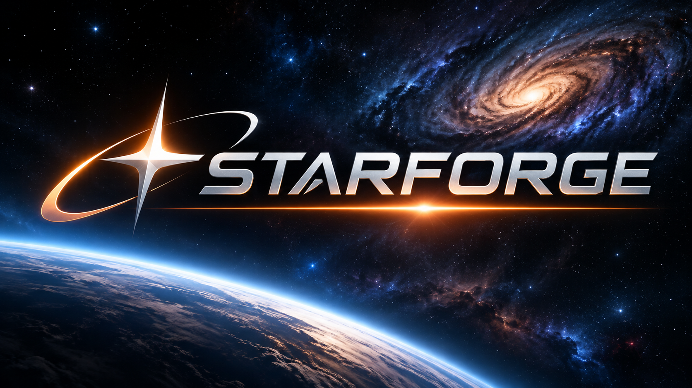

# STARFORGE

Space-focused rendering library built on Vulkan.

## Project Vision

STARFORGE is a specialized rendering library designed for
large-scale 3D space games and simulations.

Its purpose is to provide a developer-friendly interface
optimized for:

- Massive planetary environments
- Large-scale coordinate systems
- Asteroid fields
- Spacecraft and fleet rendering
- GPU-driven rendering
- Volumetric space environments
- Advanced space combat effects

See [docs/VISION.md](docs/VISION.md) for goals and non-goals.

## Technology

- C++26
- Vulkan 1.3 minimum, 1.4 preferred
- Vulkan Memory Allocator (VMA)
- GLM (wrapped behind STARFORGE math aliases)
- Slang shaders
- SDL3
- CMake
- Ninja
- Clang

## Development Platform

Linux / EndeavourOS initially.

The engine uses SDL3 for windowing, which transparently supports both X11
and Wayland. On Wayland compositors (e.g., Hyprland, Sway, GNOME on Wayland),
SDL3 automatically selects the native Wayland backend — no XWayland required.
All Vulkan surface creation, resize handling, and presentation go through
SDL3's abstraction, so the same binary works on X11 and Wayland without
recompilation.

Cross-platform architecture is a design requirement.

## Build

Configure:

    cmake --preset linux-debug

Build:

    cmake --build --preset debug
    cmake --build --preset debug --target check

Run the sandbox:

    ./build/linux-debug/bin/starforge_sandbox

Run the tests:

    ctest --preset debug
    ctest --preset debug --output-on-failure -V

Run only the headless GPU tests (or exclude them on headless CI without a GPU):

    ctest --preset debug -L gpu -V
    ctest --preset debug -LE gpu

Validation layers are enabled in Debug builds only
(`-DSTARFORGE_ENABLE_VALIDATION=OFF` to disable). Unit tests use
doctest: install the `doctest` package, or CMake fetches it automatically.

### Forcing fallback paths

Optional GPU features can be switched off at runtime to exercise
fallback code on capable hardware:

    STARFORGE_DISABLE_FEATURES=meshShader,bindless ./build/linux-debug/bin/starforge_sandbox

Overridable features: `bindless`, `drawIndirectCount`,
`multiDrawIndirect`, `shaderFloat64`, `meshShader`. Hard requirements
cannot be disabled.

## Repository Layout

    include/starforge/   Public, developer-facing headers (Vulkan-free)
    src/core/            Logging, version, foundational utilities
    src/math/            Vector, matrix, and Vulkan clip-space projection helpers
    src/spatial/         WorldPosition (int64 cell + double offset) and camera-relative math
    src/platform/        SDL3 window, surface, and event handling
    src/vulkan/          Private Vulkan backend (instance, device, swapchain, frame loop)
    src/gpu_resources/   VMA allocator, buffers, staging upload, compute pipeline
    src/bench/           Benchmark result schema, JSON I/O, and metadata
    apps/sandbox/        Thin host application for experiments
    tests/               CPU unit tests (T1) and headless GPU tests (T2/T3)
    shaders/             Slang shader sources
    third_party/         Vendored third-party libraries (VMA)
    cmake/               Build helper modules
    docs/                Vision, architecture, roadmap, decisions, AI instructions

## Architecture

Vulkan is the initial GPU backend.

The public STARFORGE API must remain independent
of Vulkan implementation details.

See [docs/ARCHITECTURE.md](docs/ARCHITECTURE.md) and
[docs/ROADMAP.md](docs/ROADMAP.md).
Accepted architectural decisions and unresolved decision points are indexed
in [docs/decisions/](docs/decisions/README.md).

## Current Development Status

Milestone M0: Project Foundation

- [x] Repository structure
- [x] C++26 configuration
- [x] Vulkan dependency
- [x] SDL3 dependency
- [x] Slang integration
- [x] Vulkan instance initialization verified on target hardware (RX 7900 XTX)

Milestone M1: Present a Frame

- [x] 1.1 Library / sandbox / tests structure
- [x] 1.2 Window separated from main
- [x] 1.3 VulkanContext (validation, GPU selection, capabilities, feature override)
- [x] 1.4 Headless VulkanDevice
- [x] 1.5 GPU resources (VMA, buffers, upload)
- [x] 1.6 Compute dispatch verified against a CPU reference
- [x] 1.7 VulkanSwapchain with resize recreation
- [x] 1.8 Frame loop and cleared frame on screen

Milestone M2: Precision and World Addressing (CPU only)

- [x] 2.0 World scale requirements note (agreed)
- [x] 2.1 Position representation characterization (float, double, int64 mm, cell+offset)
- [x] 2.2 Math library (GLM behind STARFORGE aliases) + convention tests
- [x] 2.3 WorldPosition (int64 cell + double offset, floor semantics, cell hash)
- [x] 2.4 Camera-relative conversion (double compose, float cast, large-object jitter test)
- [x] 2.5 Translation-invariance property tests (random, negative, boundaries, near-overflow)

Milestone M3: Geometry and Precision on the GPU

- [x] 3.0 Decision note (ADR-002)
- [x] 3.1a Image RAII wrapper + readback test
- [x] 3.1b Depth image + format fallback test
- [x] 3.1c Offscreen render target (color + depth) test
- [x] 3.2a Multi-stage shader CMake support
- [x] 3.2b BDA geometry infrastructure
- [x] 3.2c Graphics pipeline helper + triangle render test
- [x] 3.2d Indexed cube with per-face colors
- [x] 3.3a Reverse-Z projection math
- [x] 3.3b Depth buffer integration + ordering test
- [x] 3.4a Render-object submission
- [x] 3.4b Invariance proof (T1 + T3)
- [x] 3.4c Naive control error table
- [x] 3.5 Sandbox integration

Milestone M4: Measure

- [ ] 4.0 Decision notes: Tracy, benchmark methodology, timing modes, noise policy, metrics, JSON schema, workload profiles, budgets
- [x] 4.1a Statistics library (percentiles) + T1 tests
- [x] 4.1b JSON writer with versioned schema + T1 tests
- [x] 4.1c GPU timestamps + named scopes + T2 tests
- [x] 4.1d CPU frame timing (recording, submission, preparation, interval)
- [x] 4.1e VMA memory statistics
- [x] 4.1f Timestamp validation and availability
- [x] 4.2a Headless harness (latency + throughput modes)
- [x] 4.2b Warm-up and benchmark phases
- [x] 4.2c Noise-floor measurement
- [x] 4.2d Latency and throughput modes
- [x] 4.2e Benchmark environment reporting
- [x] 4.2f Compare tool + T1 tests
- [x] 4.3a Scene spec + scene generation + frustum culling + tests
- [x] 4.3b Naive + competent CPU-driven baselines (infrastructure ready, benchmark test verifies harness runs)
- [x] 4.3c Sweep (10k/100k/1M × ~100%/~10%/~1% visible) (infrastructure ready, sweep verified via test)
- [x] 4.3d Per-machine baseline files + re-baselining procedure (infrastructure ready, baseline files generatable)
- [ ] 4.4a Frame-time target and budget document
- [ ] 4.4b Baseline-to-budget comparison
- [ ] 4.4c Hardware scope documentation

Milestone M5.5: Job System & Multi-Threading Foundation

- [ ] 5.5.1a Work-stealing thread pool (Chase-Lev deques, thread affinity)
- [ ] 5.5.1b Task graph (counter-based dependencies, continuations)
- [ ] 5.5.1c Thread-local scratch linear allocators
- [ ] 5.5.1d CPU epoch/frame-based deferred deletion queue
- [ ] 5.5.1e Profiler integration (Tracy/Superluminal)
- [ ] 5.5.2a DeltaStore cell-partitioned concurrency
- [ ] 5.5.2b VMA multi-threaded allocation validation
- [ ] 5.5.2c WorldPosition and Math purity verification
- [ ] 5.5.3a Per-thread, per-frame-in-flight command pools
- [ ] 5.5.3b Secondary command buffers (Dynamic Rendering inheritance)
- [ ] 5.5.3c GPU-timeline deferred resource retirement queue
- [ ] 5.5.3d Asynchronous staging ring-buffer uploader
- [ ] 5.5.4a Pure functional cell generation jobs
- [ ] 5.5.4b Isolated runtime TLS RNG (non-deterministic only)
- [ ] 5.5.4c Lock-free chunk collection buffer
- [ ] 5.5.4d Multi-threaded long-flight simulation
- [ ] 5.5.5a SIMD-accelerated parallel heightfield evaluation
- [ ] 5.5.5b Parallel atmosphere LUT generation
- [ ] 5.5.5c Parallel quadtree LOD traversal
- [ ] 5.5.5d Parallel secondary command recording
- [ ] 5.5.6a ThreadSanitizer build (with driver suppressions)
- [ ] 5.5.6b Multi-core bit-exact determinism test
- [ ] 5.5.6c Scaling benchmarks (1/2/4/8/16 threads)
- [ ] 5.5.6d High-concurrency stress test

Milestone M5: GPU-Driven Rendering (Partial)

- [x] 5.1 Test Suite Decoupling & CMake Fixes (partial)
- [x] 5.2 Frustum & Math Normalization Fixes (partial)
- [x] 5.3 Winding Order & Viewport Correction
- [x] 5.4 Vulkan RAII & Image Abstraction
- [x] 5.5 Compute & Timestamp Test Hardening (partial)
- [x] 5.6 Scene Data Layout & Double-Buffered Storage
- [x] 5.7 Slang Culling Compute Shader
- [x] 5.8 Render Pass Integration & Barriers
- [x] 5.9 T2 Parity Test (Compute vs. CPU Reference)
- [ ] 5.10 Feature Fallback Verification (partial)
- [ ] 5.11 1M Instance Scaling & Baseline Comparison (partial)

Milestone M6: Deterministic Exploration

- [x] 6.1.1 Content Generation API
- [x] 6.1.2 Integer Hash Functions
- [x] 6.1.3 Scale Level Traversal
- [x] 6.2.1 Star System Generation
- [x] 6.2.2 Asteroid Field Generation
- [x] 6.2.3 Station/Outpost Generation
- [x] 6.3.1 Delta Storage API
- [x] 6.3.2 Delta Application
- [x] 6.4.1 Long Flight Simulation (correctness)
- [x] 6.4.2 Translation-Invariance at Maximum Extent

Milestone M7: Planets (Infrastructure)

- [x] 7.1.1 Cubed-sphere mapping (linear gnomonic projection, right-handed bases)
- [x] 7.1.2 Quadtree node hierarchy (6 root quadtrees, one per cube face)
- [x] 7.1.3 Split/merge criteria with hysteresis (SSE + distance-based)
- [x] 7.1.4 Adjacency invariant (2:1 balance rule)
- [x] 7.2.1 Camera-relative patch placement via LargeObjectSetup
- [x] 7.2.2 Shared patch mesh geometry (33x33 vertices) with BDA access
- [x] 7.2.3 Terrain skirts for crack elimination
- [x] 7.2.4 BDA precision validation
- [x] 7.3.1 Procedural terrain displacement (fractal noise)
- [x] 7.3.2 Seam-free normal reconstruction (central differencing)
- [x] 7.3.3 Continuous descent path testing
- [x] 7.3.4 Performance validation within planet budget
- [x] 7.4.1 Scattering model (Rayleigh + Mie with spherical phase functions)
- [x] 7.4.2 Precomputed LUTs (Transmittance, Multiple Scattering, SkyView)
- [x] 7.4.3 Sky dome and aerial perspective integration
- [x] 7.4.4 Sun direction and terminator handling

See [docs/ROADMAP.md](docs/ROADMAP.md) for details.

## License

Copyright (c) 2026 Ray Hague. All rights reserved.

This repository is published for viewing and reference only. No license is
granted to use, copy, modify, merge, publish, distribute, sublicense, or sell
this software or its documentation without prior written permission from the
copyright holder. See [LICENSE](LICENSE).

Third-party components under `third_party/` are governed by their own license
terms (for example, Vulkan Memory Allocator is licensed under the MIT License).
